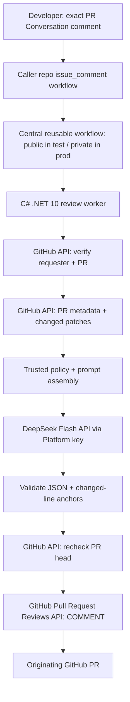

# Company PR Reviewer — Technical Architecture

**Version:** 1.3 (packaged action and caller-only concurrency)  
**Date:** 2026-10-29  
**Implementation:** C#/.NET 10 worker, central GitHub Action (public prototype → private organization release)  
**Deployment:** GitHub-hosted Actions runners (on demand)  
**Related:** [Product Requirements](01-PRODUCT-REQUIREMENTS.md) · [Development Roadmap](03-DEVELOPMENT-ROADMAP.md)

## 1. Architecture decision

Use a **centrally versioned GitHub repository** containing a .NET console worker, a composite action (`action.yml`), and a reusable workflow (`.github/workflows/review.yml`). In **Stage 1 (testing)**, this repository is **public** and owned by the developer's GitHub user account registered with company email: `YOUR_USERNAME/company-pr-reviewer`. In **Stage 2 (production)**, transfer the **same repository** to `YOUR_ORG/company-pr-reviewer` and switch visibility to **private**. Each participating private caller repository contains a small workflow listening for a new `issue_comment` event. The reviewer runs in the **calling repository's GitHub Actions context**, using its scoped `GITHUB_TOKEN` and a DeepSeek API secret passed explicitly from that caller. In Stage 1, use a repository secret on the test caller; in Stage 2, prefer a selected-repository organization secret if supported.

**This is not an ASP.NET Core server deployment.** GitHub temporarily provisions a runner, downloads the trusted central action, executes .NET, posts the review, and disposes of the runner. No permanent host, inbound webhook endpoint, queue, or database is required.

### 1.1 Logical diagram



**Trust boundary:** Caller repo event, PR description, PR diff, filenames, and changed-file contents are untrusted inputs. Central action source, reviewed default-branch workflow, and centrally controlled policy are trusted code/configuration. PR content is **never executed** by the runner.

## 2. Components and responsibilities

| Component | Owns | Does not own |
|---|---|---|
| Caller workflow | GitHub event trigger, lightweight coarse filter, per-PR concurrency, secret handoff | Review algorithms or prompt details |
| Central reusable workflow | .NET runtime execution, least privilege, timeout, calling composite action | Per-repo source-control history |
| Central composite action | Package/launch the .NET worker from `GITHUB_ACTION_PATH` | Checkout/build/run PR's head code |
| `EventParser` / `ReviewCommandParser` | Parse `GITHUB_EVENT_PATH`; normalize exact comment; derive owner/repo/PR number/commenter | Trust user-supplied values without API validation |
| `AuthorizationService` | Get current effective repo permission for commenter | Decide based only on webhook `author_association` |
| `PullRequestService` | Read PR state, base/head SHAs, diff file list; obtain bounded optional context | Execute code fetched from any branch |
| `ReviewPolicyService` | Merge central rules with safe per-repo config from trusted base SHA | Permit PR branch to override budget/security policy |
| `ReviewOrchestrator` | Enforce pipeline and state transitions | Embed provider-specific SDK details throughout |
| `ILLMProvider` | Model-independent generation request/response | Post comments or access GitHub write operations |
| `DeepSeekProvider` | DeepSeek Chat Completions request, JSON output, usage metrics | Make merge/approval decisions |
| `ReviewResultValidator` | Schema, severity, quality, max counts, changed-line mappings | Assume JSON accuracy equals factual correctness |
| `ReviewPublisher` | Recheck commit, discover duplicates, publish one COMMENT review | Approve PR, request changes, or merge |
| GitHub Actions logs/summary | Minimal outcome and measurement | Store confidential source text or secrets |

## 3. Runtime and dependencies

- **Target:** .NET 10 SDK, `net10.0` worker app, Ubuntu GitHub-hosted runner.
- **Application type:** .NET Generic Host / console worker with DI, `HttpClientFactory`, Options validation, structured `ILogger`, cancellation tokens.
- **GitHub SDK:** Octokit.NET, or typed `HttpClient` for API endpoints not conveniently exposed by Octokit. Test REST contracts against GitHub's documented API version.
- **DeepSeek Flash:** Typed `HttpClient` using DeepSeek's OpenAI-compatible `POST https://api.deepseek.com/chat/completions` with model `deepseek-flash` (or a compatible C# SDK). Configure `thinking: { type: enabled }`, `reasoning_effort: high`, and `response_format: { type: json_object }`. JSON mode needs an explicit JSON-formatted prompt; check empty/partial results and `finish_reason`.
- **Future Claude support:** Add a separate `ClaudeProvider` later without changing orchestration or GitHub integration.
- **Schema validation:** `System.Text.Json` with explicit DTOs and validators. Prefer API-supported structured output when available for the selected model; validate independently regardless.
- **Testing:** xUnit or NUnit, mocked GitHub/LLM HTTP boundaries, fixtures for events and diffs.
- **Persistence:** None for MVP. Successful review signatures live in GitHub PR review bodies; workflow logs provide diagnostics.

## 4. Repository structure

```text
company-pr-reviewer/                # Public under YOUR_USERNAME in Stage 1; private under YOUR_ORG in Stage 2
├── .github/
│   └── workflows/
│       ├── review.yml              # Reusable caller-facing workflow
│       └── ci.yml                  # Unit tests / static analysis
├── src/
│   └── Company.PrReviewer/
│       ├── Program.cs
│       ├── Hosting/                # Options, DI, environment
│       ├── GitHub/                 # Webhook event, API, diff, publisher
│       ├── Reviews/                # Orchestrator, models, policy, validation
│       ├── LLM/
│       │   ├── ILLMProvider.cs
│       │   └── DeepSeekProvider.cs
│       └── Diagnostics/            # Usage and job summary
├── tests/
│   └── Company.PrReviewer.Tests/
│       ├── Fixtures/
│       └── ...
├── config/
│   └── default-review-policy.json
├── docs/
│   ├── 01-PRODUCT-REQUIREMENTS.md
│   ├── 02-TECHNICAL-ARCHITECTURE.md
│   └── 03-DEVELOPMENT-ROADMAP.md
├── action.yml                       # Composite action
├── Company.PrReviewer.slnx
└── README.md
```

Avoid prematurely introducing clean-architecture layers for a single job. Use small testable services within one runtime project; split assemblies only when complexity justifies it.

## 5. GitHub repository and Actions configuration

### 5.1 Stage 1 — Public development repository in user account

1. Create **public** `YOUR_USERNAME/company-pr-reviewer` under the GitHub user account registered with company email. This is still **user-owned**, not owned by the organization. Put only publishable reviewer source, generic default policy, synthetic test fixtures, and documentation in it. Review the commit history for accidental leaks before publishing.
2. Keep the initial review targets in **separate private synthetic-data test repositories** owned by that same user, or use expressly authorized company test repos. Never check company PR source into the public central repo or expose real-company prompts/responses in public CI logs.
3. Create an Actions **repository secret named `DEEPSEEK_API_KEY` on each private caller test repository**, never on the public reviewer repository. Use a dedicated, company-approved DeepSeek Platform account with a small funded testing balance and monitored spend; prefer mock LLM tests until authorization and publish paths are proven.
4. In each test caller, permit the public workflow/action in its Actions policy, check for normal `issue_comment.created` execution, and reference a **reviewed commit SHA** or release tag for the public central repo. Even under a company-email account, anyone can read/fork the public repository.
5. Add CI to the public reviewer repository with **no privileged API key available to untrusted contributions**. Do not use secrets in public `pull_request` or similar untrusted CI; pin external actions to reviewed SHAs for releases.
6. If test callers live inside the company organization, confirm org Actions allow use of external public workflows and obtain explicit approval for model access and sharing source-code diffs. The public central workflow itself has no access to caller secrets except those explicitly passed by authorized private callers.

### 5.2 Stage 2 — Transfer to production organization and privatize

1. Confirm you have **permission to create a repository** in the destination organization and no conflicting `company-pr-reviewer` repository exists there; coordinate transfer approval, release sign-off, source-code/IP review, and production owners.
2. Transfer via the GitHub repository **Settings → General → Danger Zone → Transfer** to `YOUR_ORG/company-pr-reviewer`. Then change visibility to **private**, subject to organization policy. Public forks and copies of previously public content may remain visible; confidentiality cannot be restored retroactively.
3. In the new private repository, enable **Settings → Actions → General → Access → Accessible from repositories in the organization**; allow approved caller repositories in the org Actions policy.
4. Create/verify a company-controlled DeepSeek Platform account, approved spend controls or balance monitoring, and production API key. Configure an **Actions organization secret with selected-repository access** for approved private callers. If the org plan does not support this for private repositories, use tightly managed repository secrets as a fallback. **GitHub Free org secret limitations must be checked** before rollout.
5. Update **both** cross-repository references: the caller's `jobs.review.uses` path to `YOUR_ORG/company-pr-reviewer/.github/workflows/review.yml@<SHA_OR_RELEASE>`, and the central reusable workflow's composite-action `steps[*].uses` path to `YOUR_ORG/company-pr-reviewer@<SHA_OR_RELEASE>`. **GitHub Actions does not follow redirects for reusable workflows or actions**, even if Git clone URLs do. Create/pin a fresh approved production release/SHA after references are changed.
6. Recheck central repo access, Actions policy, existing workflow references, `DEEPSEEK_API_KEY` access, review posting permission, and selected repos. Run an authorized and unauthorized command smoke test in each of two private pilot repositories; confirm zero unattended reviews.
7. Disable/remove the Stage 1 caller workflows in personal-account test repositories: once the reviewer is private in the company organization, those personally owned test repositories generally **cannot consume the organization-private action**. Keep synthetic fixtures separately for local/test runs, or recreate approved test callers **inside** the organization. Update local Git remotes and any documentation pointing at the old repository location; retire temporary test credentials. Preserve release history and publish a rollback path with valid **new-owner** references.

> The **application code and review engine stay unchanged** across stages. Only repository ownership/visibility, YAML references, who holds secrets, allowed caller repositories, and governance differ. GitHub-hosted runners execute in the **calling repository's** context and consume its owner's applicable Actions allowance/billing.

> A private central action can be consumed by other **private** repositories in the same organization when sharing is enabled, not by arbitrary public caller repositories. Shared private Actions can expose indirect information through caller workflow logs, so limit public access to logs and permissions after transfer.

### 5.3 Caller workflow in each repository

The shipped source is [`.github/workflows/ai-review.yml.example`](../.github/workflows/ai-review.yml.example). Copy it to `.github/workflows/ai-review.yml` on each caller's **default branch**, removing the `.example` suffix. The central copy stays inactive. `issue_comment.created` is the only trigger; there are no push, pull-request, edited-comment, or dispatch triggers.

A credential-free PowerShell guard reads `GITHUB_EVENT_PATH` as data and checks the original event name, created action, PR conversation shape, human account type, and ordinal case-sensitive equality of the trimmed body with `@company-code-reviewer review`. It writes only `accepted=true` or `accepted=false` to its job output. Comment text is never interpolated into executable script or printed. The worker still independently validates the event and requester permission.

Only an accepted request invokes `YOUR_USERNAME/company-pr-reviewer/.github/workflows/review.yml@v0.1.0`. The caller review job grants `contents: read` and `pull-requests: write`, explicitly passes its own `DEEPSEEK_API_KEY` Actions secret as `deepseek_api_key`, and owns this concurrency group:

```yaml
concurrency:
  group: ai-review-${{ github.repository }}-${{ github.event.issue.number }}
  cancel-in-progress: false
```

The guard has no secret handoff or explicit token permissions. There is no workflow-level lock and no second lock in the called workflow. Same-repository/PR review jobs serialize without cancelling the running review; other PRs have independent groups. Older pending requests may be replaced. Configuration validation proves the lock declaration, not actual GitHub scheduler behavior; deployment and concurrent-run checks remain Phase 2 acceptance tests. History checks provide best-effort duplicate prevention rather than durable exactly-once processing.

### 5.4 Central reusable workflow

[`.github/workflows/review.yml`](../.github/workflows/review.yml) exposes only `workflow_call` and explicitly requires the named `deepseek_api_key` secret. It defaults permissions to none, restricts execution to created PR conversation events, and runs one `ubuntu-latest` job with a ten-minute timeout and the same two review permissions as its caller. It cannot elevate caller permissions and does not use `secrets: inherit` or environment-scoped secrets.

The job invokes `YOUR_USERNAME/company-pr-reviewer@v0.1.0`, passing `${{ github.token }}` as `github-token` and `${{ secrets.deepseek_api_key }}` as `deepseek-api-key`. GitHub supplies the caller's original event context and step-summary path. Neither workflow checks out caller/PR content.

Both `YOUR_USERNAME` and the proposed `v0.1.0` release are deployment placeholders, not evidence that a remote repository or tag exists. Publish a reviewed release containing the action and reusable workflow before installing callers, and verify both reference locations against the intended release/SHA. Pinning a workflow does not implicitly pin the separately referenced action. GitHub does not redirect action/workflow references after ownership transfer, so update both reference locations under the new owner.

### 5.5 Central composite action

The root [`action.yml`](../action.yml) declares only the two required token/key inputs. It pins `actions/setup-dotnet` v6.0.0 to commit `a98b56852c35b8e3190ac28c8c2271da59106c68` and installs stable `10.0.x`. Root [`global.json`](../global.json) selects SDK `10.0.100` with `rollForward: latestFeature` and `allowPrerelease: false`, preventing a newer preinstalled major SDK from taking over.

PowerShell publish/run steps explicitly use the action directory. The publish step builds only `Ten28-PrReviewer/Ten28-PrReviewer.csproj` in Release mode, placing publish and intermediate artifacts in a unique `RUNNER_TEMP` directory. The action ref becomes `InformationalVersion`, with automatic source-revision suffixing disabled, so duplicate detection distinguishes remote worker releases. An empty action ref fails before publishing; direct local `uses: ./` is not a supported packaged invocation.

Only the subsequent DLL execution step receives `GITHUB_TOKEN` and `DEEPSEEK_API_KEY`. Arguments and paths use environment bindings rather than interpolated script expressions; original event variables and `GITHUB_STEP_SUMMARY` remain intact. Native publish/worker failures propagate their exit codes. There are no caller checkouts, caches, project/command override inputs, or persistent package artifacts. Local contract/script tests cover paths containing spaces, credential scope, guard adversarial cases, and exit-code propagation; an actual publish/startup smoke verifies appsettings copying and release identity without credentials or an applicable event.

### 5.6 Release, ownership-transfer and version strategy

- CI runs tests/build/security checks on the central repo in both stages; public CI must have **no live DeepSeek secrets on untrusted events**.
- Publish vetted release tags (`v1.0.0`, `v1.0.1`), preferably **pin caller and composite `uses:` references to verified full commit SHAs**. Tags are not intrinsically immutable; protect releases/tags per available plan features.
- During Stage 1, references use `YOUR_USERNAME/company-pr-reviewer`. After transfer and privatization, update every caller and the central workflow to `YOUR_ORG/company-pr-reviewer`, then pin to newly reviewed production commits. A transfer does **not** automatically repair YAML `uses:` values.
- The central reusable workflow's action ref must match the intended worker release. Test the Stage 2 private access grant before rollout; use small PRs to update caller refs.
- Optionally adopt a protected moving `v1` channel only if the team explicitly approves automatic upgrades. Track exact deployed SHAs and maintain a rollback release/reference under the **current** owner.
- Keep development/test and production secrets separately controlled; revoke/discard temporary test credentials after migration.

## 6. Event processing and authorization

**Input sources:** `GITHUB_EVENT_PATH`, `GITHUB_REPOSITORY`, `GITHUB_RUN_ID`, `GITHUB_TOKEN`, `DEEPSEEK_API_KEY`.

1. Validate event name `issue_comment` and action `created`.
2. Verify issue payload contains `pull_request`, the PR is open, actor type is human, and the **entire comment** matches the command after trim.
3. Re-fetch the PR and comment from the GitHub REST API; don't assume event content is still current.
4. Re-fetch the requester's current effective access using `GET /repos/{owner}/{repo}/collaborators/{username}/permission`. Require legacy permission `write` or `admin` (GitHub maps `maintain` to `write`); deny `read`, `none`, and missing/inaccessible accounts. GitHub's fine-grained token docs list **Metadata: read** for this endpoint; test with the actual `GITHUB_TOKEN` in the pilot.
5. Check repo allowlist/enrollment and allowed PR status before expensive calls.
6. Do not execute code from the PR head or load configuration from that branch.

**Failure behavior:** Missing permission or failed verification is a deny, not a fallback to `author_association`. Report a sanitized failure in the Actions job summary; do not leak private repository/member data.

## 7. Diff collection and context building

### 7.1 Primary API sequence

- `GET /repos/{owner}/{repo}/pulls/{number}` — open status, base/head SHA, head repository, merge metadata.
- `GET /repos/{owner}/{repo}/pulls/{number}/files` — paginate to obtain file path, status, additions/deletions, and patch if present.
- `GET /repos/{owner}/{repo}/contents/.github/ai-review.json?ref={trusted-base-sha}` — optional per-repo safe settings from the base commit, **not PR head**.
- Optionally request bounded adjacent source context in a later slice; MVP uses patches and metadata, with a clear partial-context disclaimer.

GitHub's list-files endpoint is paginated and caps the returned files at 3,000; **our configured review cap is much smaller**. Treat renamed files carefully (use the new path for inline comments), and consider deleted files unanchorable in the MVP (`RIGHT` lines only).

### 7.2 Filtering and budgets

Initial recommended defaults (configuration, not hard-coded platform constraints):

```json
{
  "maxChangedFilesAnalyzed": 30,
  "maxTotalPatchBytes": 250000,
  "maxSinglePatchBytes": 40000,
  "maxFindings": 10,
  "maxOutputTokens": 16384,
  "maxReviewSeconds": 480,
  "allowedExtensions": [".cs", ".csproj", ".json", ".sql", ".ts", ".tsx", ".js"],
  "excludedGlobs": ["**/bin/**", "**/obj/**", "**/dist/**", "**/*.min.js", "**/*lock*"]
}
```

Always exclude binary, missing-patch, excessively large, generated, or unsupported files from analysis and **count/report them as skipped**. Do not silently truncate a file and claim it was completely reviewed. For partial patch sampling, label the exact scope, or skip that file for MVP.

## 8. Prompt construction, structured output, and validation

**Prompt design:** central fixed instructions set reviewer role, allowed concerns, evidence threshold, exclusion rules, input budget, and schema. Supply diffs as clearly delimited *untrusted data*, not as instructions. PR titles, descriptions, comments, and repository files can contain attempted prompt injection; The model must not be granted arbitrary shell/GitHub write tools.

Recommended response contract:

```json
{
  "summary": "string",
  "findings": [
    {
      "severity": "high",
      "title": "Potential null dereference",
      "path": "src/Orders/OrderService.cs",
      "line": 84,
      "side": "RIGHT",
      "explanation": "Observed behavior and a plausible failure path",
      "recommendation": "Specific corrective action"
    }
  ]
}
```

**Validation pipeline:**

- Parse strict JSON; reject extras/invalid values as configured.
- Clamp descriptions/counts; remove empty, duplicate, generic, stylistic, or unsupported items.
- Restrict severities; default unknown values to rejection, not silent escalation.
- Ensure file belongs to analyzed changed-file set; normalize and compare GitHub paths without filesystem traversal.
- Parse the unified diff hunk headers; verify `line` is on a visible added or modified **RIGHT-side** line. Never trust model-supplied line numbers alone.
- If finding is useful but unanchorable, omit inline comment and optionally include it as a labeled unanchored observation in the summary (with explicit lower confidence); never create invalid review payloads.
- Cap total findings to ten; prefer meaningful issues over volume.

## 9. Review publishing, deduplication, and races

1. Compute a lowercase SHA-256 key over deterministic JSON containing the normalized repository owner/name, PR number, lowercase head SHA, policy version and effective-policy hash, requested model ID, and worker assembly informational version. The policy hash includes instructions, limits, and case-normalized, distinct, sorted extension/exclusion sets. Worker releases that should permit re-review must change their informational version. The requested model alias is available through `ILLMProvider.ModelId` before generation; response-reported model revisions remain usage metadata.
2. Search `GET /repos/{owner}/{repo}/pulls/{number}/reviews` for a valid marker **only on submitted `COMMENTED` reviews authored by `github-actions[bot]` with account type `Bot`**, matching the reviewed commit and application key. The code-generated marker contains canonical Base64-encoded JSON with `key` and the complete identity, for example:

   ```html
   <!-- company-pr-reviewer:v1 BASE64_ENCODED_IDENTITY_JSON -->
   ```

3. After authorization, snapshot/policy retrieval, and input selection, search history before generation. A matching successful review skips generation and publication, retaining its numeric review ID. History uses 100 reviews per page, at most 30 pages, 10 MiB per response, 32 MiB aggregate, and one 30-second deadline. Full pages require continuation to establish absence; incomplete, ambiguous, unsuccessful, or over-budget searches fail closed. Human/other-bot markers, pending/dismissed reviews, and legacy unmarked bodies do not establish duplicates. The first request after upgrading from unmarked reviews may publish one marked review.
4. After model validation, search history again to avoid publishing a review another run has already completed; retain usage incurred before this late skip. The publisher then fetches PR metadata again. If closed or either head/base SHA changed, **abort without posting**; a developer can request again for the current commit.
5. Submit one GitHub PR review using `POST /repos/{owner}/{repo}/pulls/{number}/reviews` with `event: COMMENT`, explicit `commit_id=head.sha`, body, and bounded inline comments with valid `path`, `line`, `side` fields. Do not use deprecated diff `position`.
6. An explicit inline-location validation rejection (`422`) permits **at most one** summary-only `COMMENT` attempt after another PR metadata check. Preserve the application marker and validated findings in that body; do not log finding text. Ambiguous 422 responses, rate limits, and uncertain writes do not automatically retry. A later manual request reconciles a possibly successful write through fresh review history.

**Concurrency caveat:** Workflow-level per-PR concurrency reduces races; bot-authored marker lookup provides best-effort idempotency, not transactional exactly-once delivery. Model API failures or GitHub write failures must not create a false success marker.

## 10. Secret handling and attack surface

### Required minimum controls

- `GITHUB_TOKEN`: short-lived, repo-scoped. Explicit permissions: `contents: read`, `pull-requests: write`; collaborator-permission lookup uses implicit metadata read access. No issue API calls are needed by the current worker. Revalidate actual endpoints against token capabilities during pilot.
- `DEEPSEEK_API_KEY`: passed only to trusted central action via explicitly named reusable-workflow secret. In Stage 1, keep it in each **private test caller's repository secret**; never in the public central repository. In Stage 2, prefer selected-repository organization secret access, company-approved DeepSeek account and cost-monitoring controls.
- Do **not** run `actions/checkout` for the contributor branch, nor `dotnet build`, `npm install`, scripts, Makefiles, or tests originating from PR code when the job has secrets.
- Do not eval/execute code extracted from diff, model output, or comment.
- Require exact command and live permission check **before** any model call.
- Do not expose API key, Authorization headers, raw prompts, raw diffs, or model outputs in logs/artifacts.
- Treat model replies as untrusted text. Escape/limit Markdown content before publication, and do not interpret suggested shell commands as instructions.
- Apply development-stage public-repository controls: only approved publishable code and synthetic fixtures; public PR CI cannot access production keys; avoid sensitive public workflow logs; audit repository history before transfer. After migration, apply org-level permissions, dependency SHA pinning, protected central repo, secret rotation and incident response.
- Use `CancellationToken`/timeouts and HTTP resilience on both GitHub and DeepSeek APIs; avoid unlimited retries or 429 retry storms.

### Data governance

Sending proprietary source code to any third-party AI API requires company policy approval. Document which repositories/file types are allowed, provider data handling terms, relevant jurisdictional requirements, and whether secrets/credentials should be detected and redacted before sending. DeepSeek's Open Platform terms and applicable privacy/data-processing obligations must be reviewed before submitting proprietary company code. The public pilot uses only synthetic PRs.

## 11. Error handling and observability

| Error condition | Handling |
|---|---|
| Missing/invalid comment | Exit cleanly; no API call |
| Permission lookup fails or insufficient permission | Fail closed and summarize reason; no model call |
| PR closed or not found | Skip and record |
| Duplicate review key | Skip and record existing review URL if available |
| Patch unavailable/over limit | Skip affected files; disclose incomplete coverage |
| DeepSeek 429/5xx | Bounded exponential backoff plus jitter; respect timeout and retry-after |
| DeepSeek 401/403/insufficient balance | Stop immediately; redact secret; owner action required |
| Malformed model response | One bounded structured repair/retry only if budget permits; otherwise fail with no misleading review |
| GitHub review 422 | Revalidate SHA/positions; optional single summary-only fallback |
| PR head changed | Abort stale response without submitting |
| Failed GitHub publish | Fail job visibly; do not mark successful review |

**Log fields:** organization/repository, PR number, comment ID, request actor, head SHA, review key, model ID, input/output tokens as returned, reviewed/skipped file counts, finding counts by severity, elapsed time, GitHub/DeepSeek status class, and outcome. Avoid source-text logging. Where feasible, include an estimated USD cost using **configurable** token rates; DeepSeek Platform billing remains the source of truth.

**SLICE-1.11 diagnostics:** The worker retains the current/failing stage, total and per-stage elapsed milliseconds from `TimeProvider`, requested/recognized reported model identity, available HTTP status and retry time, prior review ID, and known publication-delivery uncertainty. Capture usage immediately after generation so downstream failures retain it; unavailable token counts remain unknown, and skipped generation is explicit. Emit structured terminal logs and append a compact Markdown table to `GITHUB_STEP_SUMMARY` when set. Identifier metadata is bounded, allowlisted, and checked against configured/process credentials; arbitrary exception messages, response bodies, prompts, patches, findings, and HTTP request traces are excluded. A missing summary path is normal locally; a failed write emits a fixed warning without changing exit status. Cost estimation and cumulative billing across failed provider attempts are not implemented. Existing exit codes remain `0` for completion/intentional skip, `1` for operational failure, and `130` for cancellation.

## 12. Testing and rollout strategy

- **Unit:** exact command parser; webhook validation; permission matrix; per-repo config schema/limits; diff hunk parser including rename/add/delete; prompt escape/delimiters; line validator; dedup marker; budget cap.
- **Integration:** stub GitHub and DeepSeek endpoints; ensure forbidden user has zero DeepSeek invocations; stale SHA abort; duplicate same SHA skip; missing patch disclosure; malformed JSON; provider retry limit; publish summary-only fallback.
- **Stage 1 GitHub Actions smoke:** invoke public central workflow from a **private synthetic-data caller repo** under the user account; verify caller repo secret, composite action path, `contents: read`/`pull-requests: write` and implicit metadata permissions, same-PR serialization, and independent processing for different PRs. If an approved org test repo is used, verify its policy allows the public workflow.
- **Stage 2 GitHub Actions smoke:** after transfer and privatization, verify org private sharing, new-owner references at both workflow and composite-action layers, selected-repository org secret availability (or documented fallback), and review behavior on two private org repositories.
- **Security regression:** malicious comment text, adversarial PR diff prompt injection, overly large filenames and patches, fork-origin diff treated strictly as data, secret redaction.
- **Pilot:** development first uses synthetic reviews; after organizational approval, evaluate 15–20 historical company PRs and live on-demand requests on two approved **private company repositories**. Do not copy company PR source or evaluation logs into the public central repo. Collect cost/review and human-judged usefulness before expansion.

## 13. Alternatives and evolution

| Alternative | MVP decision | Rationale |
|---|---|---|
| .NET Worker on GitHub Actions | **Choose** | On-demand execution, no server, C# fit, centralized code |
| ASP.NET Core hosted webhook | Defer | Adds hosting, installation lifecycle, web security, queue needs |
| GitHub App bot identity | Defer | Useful for true `@company-code-reviewer` mention, org-wide webhook installation, but requires more infrastructure |
| Claude Code GitHub Action | Not chosen | Pilot avoids waiting for Claude Console setup; keep automation provider-neutral |
| PR-Agent open source | Benchmark later | Reduces bespoke code but adds a different configuration and runtime footprint |
| Claude/Qwen | Adapter reserved | Only consider after evaluating DeepSeek Flash quality, budget and vendor approval |

## 14. Current authoritative documentation

- GitHub — Reusable workflow access/no redirect: https://docs.github.com/en/actions/reference/workflows-and-actions/reusing-workflow-configurations
- GitHub — Repository transfer: https://docs.github.com/en/repositories/creating-and-managing-repositories/transferring-a-repository
- GitHub — Visibility changes and public forks: https://docs.github.com/en/repositories/managing-your-repositorys-settings-and-features/managing-repository-settings/setting-repository-visibility
- GitHub — Share with organization: https://docs.github.com/en/actions/how-tos/reuse-automations/share-with-your-organization
- GitHub — Reuse workflows, pass named secrets: https://docs.github.com/en/actions/how-tos/reuse-automations/reuse-workflows
- GitHub — `issue_comment` event/default branch: https://docs.github.com/en/actions/reference/workflows-and-actions/events-that-trigger-workflows
- GitHub — Organization secrets and Free-plan limitations: https://docs.github.com/en/actions/how-tos/write-workflows/choose-what-workflows-do/use-secrets
- GitHub — Get collaborator effective permissions: https://docs.github.com/en/rest/collaborators/collaborators
- GitHub — Get PR changed files: https://docs.github.com/en/rest/pulls/pulls
- GitHub — PR Reviews API: https://docs.github.com/en/rest/pulls/reviews
- GitHub — Concurrency behavior: https://docs.github.com/en/actions/how-tos/write-workflows/choose-when-workflows-run/control-workflow-concurrency
- GitHub — Risks from running untrusted PR code: https://docs.github.com/en/actions/reference/security/securely-using-pull_request_target
- DeepSeek — API Quick Start: https://api-docs.deepseek.com/api/responses
- DeepSeek — Chat Completions: https://api-docs.deepseek.com/api/create-chat-completion/
- DeepSeek — JSON Output: https://api-docs.deepseek.com/guides/json_mode/
- DeepSeek — Pricing: https://api-docs.deepseek.com/quick_start/pricing/
- DeepSeek — Open Platform Terms: https://cdn.deepseek.com/policies/en-US/deepseek-open-platform-terms-of-service.html

---

**Rollout dependency:** Prove safe end-to-end flow on synthetic data from the public user-owned reviewer, then transfer, privatize, update all action/workflow references and secrets, and pass the two-private-repository organization smoke test before production rollout. The YAML samples are reference templates and should be validated in a test repository before production use.
